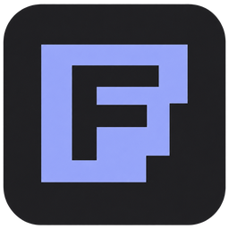
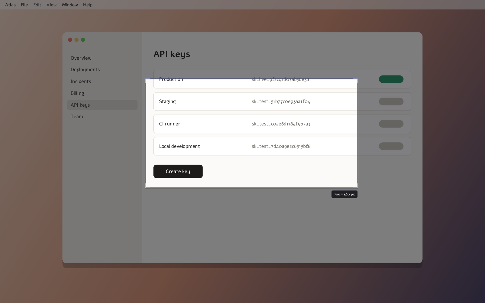
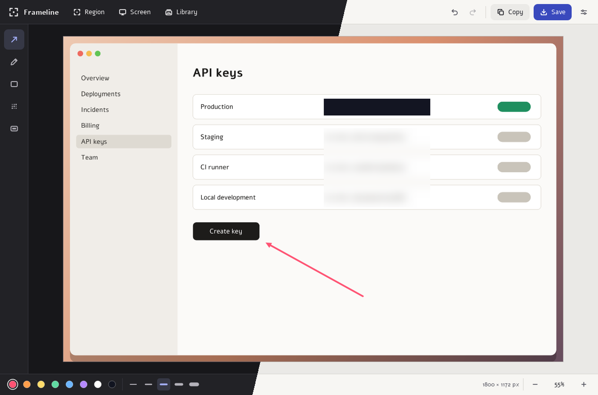
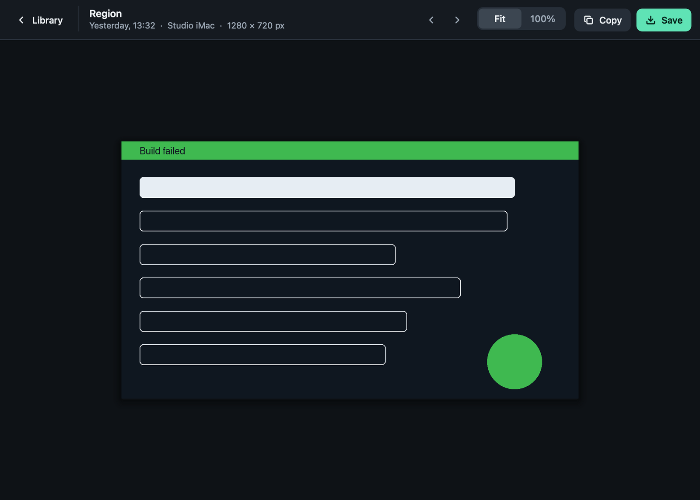
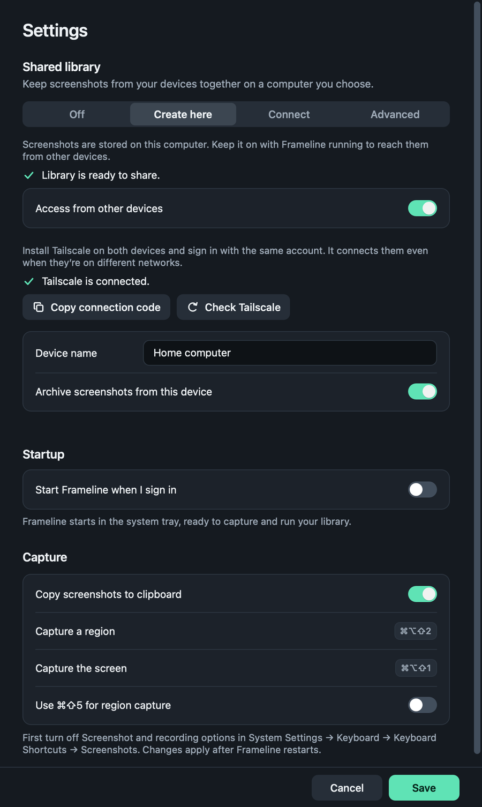

<p align="center">
  
</p>

<h1 align="center">Frameline</h1>

<p align="center">
  <strong>Capture it. Mark it up. Share it.</strong><br>
  A fast, native screenshot tool for Windows, macOS and Linux,<br>
  with an optional library you host yourself.
</p>

<p align="center">
  <a href="https://github.com/Xopoko/Frameline/actions/workflows/build.yml"></a>
  
  
  
  <a href="LICENSE"></a>
</p>

<p align="center">
  
</p>

## Why Frameline

- **One shortcut away.** Press `⌘⌥⇧2` or `Ctrl+Alt+Shift+2` in any app. The screen freezes, so menus and tooltips stay where they were while you drag.
- **Markup before sharing.** Redact covers sensitive details in the edited image. Blur softens details. Annotate with arrows, pen or rectangles, with full undo.
- **Native on every desktop.** C++ and Qt Widgets. Capture, edit and save without an account. It follows your system's light or dark appearance.
- **Automatic local history.** Open Library to find your captures on this device. You can also share screenshots across devices through Tailscale or an existing SSH library.
- **Scriptable.** Capture from the command line or a desktop shortcut, straight to a PNG.

## A closer look

<table>
  <tr>
    <td width="50%"></td>
    <td width="50%"></td>
  </tr>
  <tr>
    <td><strong>Select on a frozen screen.</strong> Crosshair guides line up the first corner and the badge shows the exact size in pixels.</td>
    <td><strong>Mark up in light or dark.</strong> Choose a tool on the left, then adjust its color or stroke width below the screenshot.</td>
  </tr>
  <tr>
    <td></td>
    <td></td>
  </tr>
  <tr>
    <td><strong>Find past captures.</strong> Browse your screenshots newest first, with the device and time on each.</td>
    <td><strong>Open, copy, save again.</strong> Step through with the arrow keys, view at actual size, copy to the clipboard.</td>
  </tr>
</table>

## Install

Download the package for your system from [Releases](https://github.com/Xopoko/Frameline/releases).

- **Windows 10 1809+ / 11, x64**: extract the ZIP and run `bin/FramelineGUI.exe`. The CLI is `bin/frameline.exe`.
- **macOS 14.4+**: move `Frameline.app` to Applications, allow it in **System Settings → Privacy & Security → Screen & System Audio Recording**, then reopen it.
- **Ubuntu 24.04, amd64**: `sudo apt install ./frameline_<version>_amd64.deb`. Works on X11 and on GNOME Wayland through the screenshot portal.

Frameline was called ScreenFrame up to version 0.3.0. When you upgrade to Frameline, your settings, queued uploads, a library kept on this computer and the choice to start at sign-in carry over on first launch. On Ubuntu the new package replaces `screenframe` and keeps the `screenframe` command working. On macOS, allow Frameline to record the screen once more, and delete the old ScreenFrame app.

## Usage

| Action | Windows and Linux | macOS |
| --- | --- | --- |
| Capture the screen under the pointer | `Ctrl+Alt+Shift+1` | `⌘⌥⇧1` |
| Capture a region | `Ctrl+Alt+Shift+2` | `⌘⌥⇧2` |

Global shortcuts work while Frameline is running, including from the tray. In **Settings** you can move region capture to the system key instead: `Win+S`, `⌘⇧5` or `Super+S`. On macOS, first turn off **Screenshot and recording options** under **System Settings → Keyboard → Keyboard Shortcuts → Screenshots**.

Turn on **Start Frameline when I sign in** in **Settings** and save to start Frameline in the tray at your next login. If you move the app to a new location, enable the setting from that copy.

For a region, drag over the frozen screen and release. `Esc` or a right click cancels.

Frameline opens new screenshots in the editor and copies them to the clipboard by default. In **Settings → Capture**, you can turn off **Show editor after capture** or **Copy screenshots to clipboard** independently.

| In the editor | Keys |
| --- | --- |
| Arrow, Pen, Rectangle, Blur, Redact | `A` `P` `R` `B` `X` |
| Copy, save | `⌘C` `⌘S` / `Ctrl+C` `Ctrl+S` |
| Undo, redo | `⌘Z` `⇧⌘Z` / `Ctrl+Z` and `Ctrl+Y` (Windows) or `Ctrl+Shift+Z` (Linux) |
| Zoom | `+` `-`, `Ctrl`+scroll or pinch; `0` fits, `1` is actual size |

Use Redact rather than Blur for sensitive details. In the library viewer, `←` and `→` move between screenshots.

### Linux notes

On Wayland the desktop may ask for permission to capture, and GNOME may also save its own copy in Pictures. A full-screen capture is whatever the screenshot portal returns, usually the whole desktop, and region capture shows it on one monitor.

On Wayland, automatic copying uses `wl-clipboard`, which is installed with the `.deb` package.

The Ubuntu 24.04 package uses that release's Qt 6.4, which does not report the system appearance, so Frameline stays dark there. Start it with `FRAMELINE_THEME=light` for the light appearance.

GNOME can run `frameline capture region` on `Super+S` even when Frameline is closed:

```sh
python3 /usr/share/frameline/configure-gnome-shortcut.py install   # or: status, remove
```

If the global shortcuts portal is missing, bind `frameline capture full` and `frameline capture region` as custom shortcuts in your desktop settings.

## Library

Frameline saves the original of each new capture on this device and shows it in **Library**. Open it from the editor, the tray or `frameline library`.

### Sync across devices



To share screenshots, open **Settings → Sync across devices → Host here** on the host computer and select **Create shared library**.

To connect another computer, including over the internet:

1. Install Tailscale on both computers and sign in with the same account. [Get Tailscale](https://tailscale.com/download)
2. On the computer with the library, turn on **Access from other devices**, select **Apply sharing**, then **Copy connection code**. If Frameline has not detected Tailscale yet, select **Check Tailscale**.
3. On the other computer, open **Settings → Sync across devices → Connect**, paste the code and select **Connect**. Frameline checks the connection before saving it. Keep the code private. It grants read and write access to your library.

If the connection check fails, make sure the library computer is awake, Frameline is running, and both computers are connected to Tailscale with the same account. **Start Frameline when I sign in** brings the library back when you sign in on its computer.

Enable **Upload screenshots from this device** for automatic uploads. Frameline uploads the final image when you close the editor, take another capture or quit. Failed uploads stay in the queue and retry. In Library, use **Shared** to browse the connected library.

For a separately managed server, choose **Advanced** and see the [standalone server instructions](server/README.md).

<br clear="right">

## Command line

```sh
frameline                     # open the editor
frameline --tray              # start in the tray
frameline library
frameline settings
frameline capture full
frameline capture region --output area.png
frameline capture full --output shot.png --no-preview
```

On macOS the binary is `Frameline.app/Contents/MacOS/Frameline`. `--output` writes the unedited capture; `--no-preview` exits right after. Exit codes: `0` success, `1` error, `2` cancelled.

## Building

Requirements: CMake 3.21.1+, a C++20 compiler and Qt 6.4+ (Qt 6.8+ with MSVC on Windows). Pass `-DCMAKE_PREFIX_PATH=/path/to/Qt` if CMake does not find Qt.

```sh
sudo apt install build-essential cmake ninja-build qt6-base-dev qt6-wayland libx11-dev libxcb1-dev  # Ubuntu
cmake -S . -B build -G Ninja -DCMAKE_BUILD_TYPE=Release
cmake --build build
ctest --test-dir build --output-on-failure
python3 -B -m unittest discover -s server
```

`cmake --install build --prefix <dir>` stages a self-contained app on Windows and macOS. On Ubuntu, `cpack --config build/CPackConfig.cmake -B dist` builds the DEB.

The screenshots and the demo above come from the app itself: `build/frameline_shots <dir>` renders every window and state, and `--demo-editor` / `--demo-region` record the demo frames. See [architecture](docs/architecture.md).

## Contributing

Bug reports and pull requests are welcome. Read [CONTRIBUTING.md](CONTRIBUTING.md) first, use sample content in screenshots, and report security issues privately as described in [SECURITY.md](SECURITY.md). More: [architecture](docs/architecture.md), [releasing](docs/release.md).

Frameline is MIT-licensed; bundled Qt components keep their own licenses.
