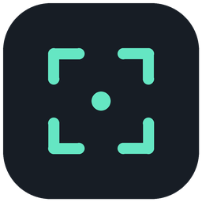
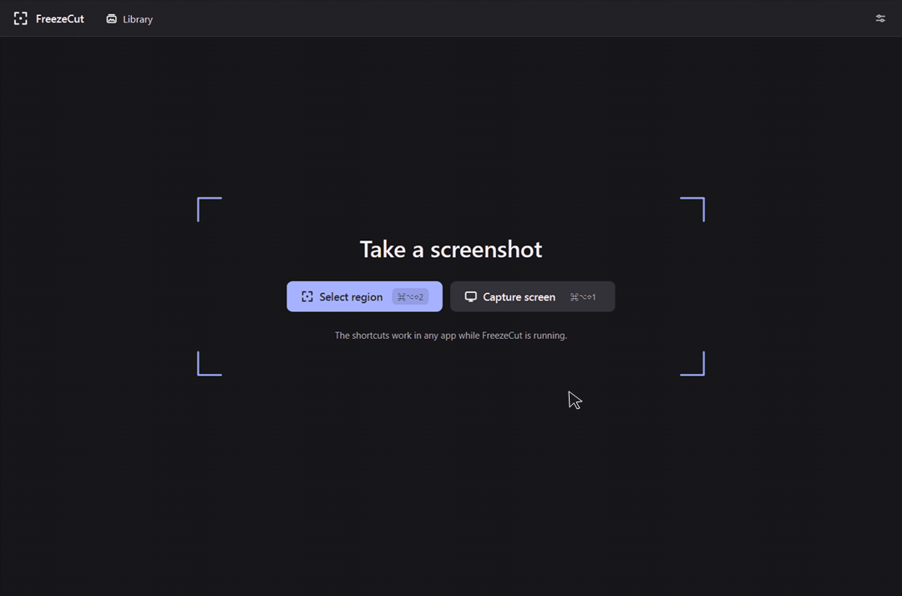
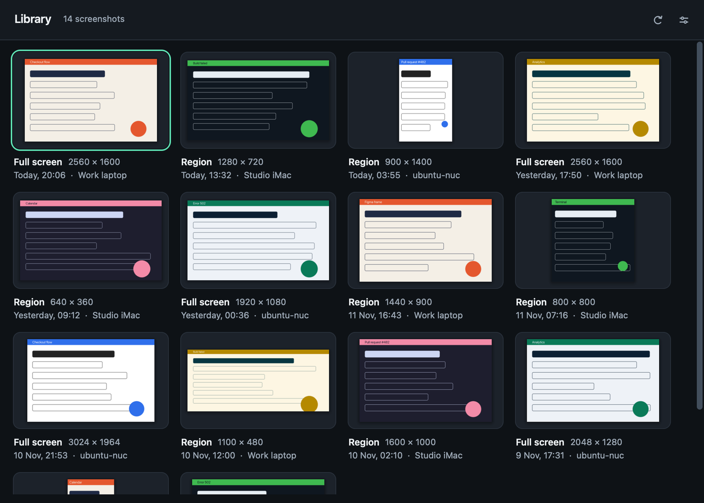

<p align="center">
  
</p>

<h1 align="center">ScreenFrame</h1>

<p align="center">
  <strong>Capture it. Mark it up. Share it.</strong><br>
  A fast, native screenshot tool for Windows, macOS and Linux,<br>
  with an optional library you host yourself.
</p>

<p align="center">
  <a href="https://github.com/Xopoko/ScreenFrame/actions/workflows/build.yml"></a>
  
  
  
  <a href="LICENSE"></a>
</p>

<p align="center">
  
</p>

## Why ScreenFrame

- **One shortcut away.** Press `⌘⌥⇧2` or `Ctrl+Alt+Shift+2` in any app. The screen freezes, so menus and tooltips stay where they were while you drag.
- **Markup that keeps secrets secret.** Redact paints a solid block over keys and passwords; Blur softens the rest. Arrows, pen and rectangles for everything else, with full undo.
- **Native, not a browser in disguise.** C++ and Qt Widgets, no account and no cloud. It follows your system's light or dark appearance.
- **Your screenshots, on your server.** The optional library is one Python file with no dependencies. Devices reach it locally or over SSH, failed uploads wait in a local queue, and every device can browse everything.
- **Scriptable.** Capture from the command line or a desktop shortcut, straight to a PNG.

## A closer look

<table>
  <tr>
    <td width="50%"></td>
    <td width="50%"></td>
  </tr>
  <tr>
    <td><strong>Select on a frozen screen.</strong> Crosshair guides line up the first corner and the badge shows the exact size in pixels.</td>
    <td><strong>Mark up in light or dark.</strong> Tools, colors and stroke widths live in one floating bar; the screenshot gets the rest of the window.</td>
  </tr>
  <tr>
    <td></td>
    <td></td>
  </tr>
  <tr>
    <td><strong>Every device, one library.</strong> Screenshots from all your machines, newest first, with the device and time on each.</td>
    <td><strong>Open, copy, save again.</strong> Step through with the arrow keys, view at actual size, copy to the clipboard.</td>
  </tr>
</table>

## Install

- **Windows 10 1809+ / 11, x64**: extract the ZIP and run `bin/ScreenFrameGUI.exe`. The CLI is `bin/screenframe.exe`.
- **macOS 14.4+**: move `ScreenFrame.app` to Applications, allow it in **System Settings → Privacy & Security → Screen & System Audio Recording**, then reopen it.
- **Ubuntu 24.04, amd64**: `sudo apt install ./screenframe_0.2.0_amd64.deb`. Works on X11 and on GNOME Wayland through the screenshot portal.

## Usage

| Action | Windows and Linux | macOS |
| --- | --- | --- |
| Capture the screen under the pointer | `Ctrl+Alt+Shift+1` | `⌘⌥⇧1` |
| Capture a region | `Ctrl+Alt+Shift+2` | `⌘⌥⇧2` |

Global shortcuts work while ScreenFrame is running, including from the tray. In **Settings** you can move region capture to the system key instead: `Win+S`, `⌘⇧5` or `Super+S`. On macOS, first turn off **Screenshot and recording options** under **System Settings → Keyboard → Keyboard Shortcuts → Screenshots**.

For a region, drag over the frozen screen and release. `Esc` or a right click cancels.

| In the editor | Keys |
| --- | --- |
| Arrow, Pen, Rectangle, Blur, Redact | `A` `P` `R` `B` `X` |
| Copy, save | `⌘C` `⌘S` / `Ctrl+C` `Ctrl+S` |
| Undo, redo | `⌘Z` `⇧⌘Z` / `Ctrl+Z` and `Ctrl+Y` (Windows) or `Ctrl+Shift+Z` (Linux) |
| Zoom | `+` `-`, `Ctrl`+scroll or pinch; `0` fits, `1` is actual size |

Use Redact rather than Blur for sensitive details. In the library viewer, `←` and `→` move between screenshots.

### Linux notes

On Wayland the desktop may ask for permission to capture, and GNOME may also save its own copy in Pictures. A full-screen capture is whatever the screenshot portal returns, usually the whole desktop, and region capture shows it on one monitor.

GNOME can run `screenframe capture region` on `Super+S` even when ScreenFrame is closed:

```sh
python3 /usr/share/screenframe/configure-gnome-shortcut.py install   # or: status, remove
```

If the global shortcuts portal is missing, bind `screenframe capture full` and `screenframe capture region` as custom shortcuts in your desktop settings.

## Shared library


The library is a small Python server you host yourself. Devices reach it on the same machine or through an SSH tunnel, and every device with the access token can browse all screenshots.

1. On an Ubuntu host, run `bash scripts/install-ubuntu-library.sh` as your user. See [server/README.md](server/README.md) for other hosts.
2. On each device, open **Settings**, choose **This computer** or **Over SSH** under **Shared library**, and enter the port, token and a device name. The SSH host must be an OpenSSH alias that connects without prompting. **Test connection** checks it before you save.
3. Turn on **Archive screenshots from this device** where you want uploads.

With archiving on, the final edited image is uploaded when you close the editor, take another capture or quit. Uploads that fail are kept locally and retried. Browse the library from the editor, the tray or `screenframe library`.

<br clear="right">

## Command line

```sh
screenframe                     # open the editor
screenframe --tray              # start in the tray
screenframe library
screenframe capture full
screenframe capture region --output area.png
screenframe capture full --output shot.png --no-preview
```

On macOS the binary is `ScreenFrame.app/Contents/MacOS/ScreenFrame`. `--output` writes the unedited capture; `--no-preview` exits right after. Exit codes: `0` success, `1` error, `2` cancelled.

## Building

Requirements: CMake 3.21.1+, a C++20 compiler and Qt 6.4+ (Qt 6.8+ with MSVC on Windows). Pass `-DCMAKE_PREFIX_PATH=/path/to/Qt` if CMake does not find Qt.

```sh
sudo apt install build-essential cmake ninja-build qt6-base-dev qt6-wayland libx11-dev libxcb1-dev  # Ubuntu
cmake -S . -B build -G Ninja -DCMAKE_BUILD_TYPE=Release
cmake --build build
ctest --test-dir build --output-on-failure
python3 -B -m unittest discover -s server
```

`cmake --install build --prefix <dir>` stages a self-contained app on Windows and macOS. On Ubuntu, `cpack --config build/CPackConfig.cmake -B dist` builds the DEB.

The screenshots and the demo above come from the app itself: `build/screenframe_shots <dir>` renders every window and state, and `--demo-editor` / `--demo-region` record the demo frames. See [architecture](docs/architecture.md).

## Contributing

Bug reports and pull requests are welcome. Read [CONTRIBUTING.md](CONTRIBUTING.md) first, use sample content in screenshots, and report security issues privately as described in [SECURITY.md](SECURITY.md). More: [architecture](docs/architecture.md), [releasing](docs/release.md).

ScreenFrame is MIT-licensed; bundled Qt components keep their own licenses.
